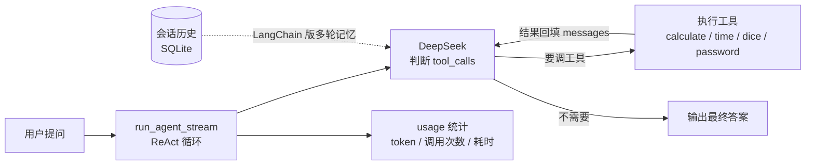

# 🤖 多工具智能体（Agent）

一个基于 **DeepSeek 函数调用（Function Calling）** 的多工具智能体：给大模型配上 4 个工具，它会自己判断「要不要调工具、调哪个、传什么参数」，**思考过程全程可见**，不是黑盒。

> **一句话看懂**：Agent = 大模型 + 工具（模型自主决策调用）。与 RAG（大模型 + 知识库，检索文档回答）互补，是大模型落地的两大核心范式之一。

## 这个项目证明什么（面向面试官）

- 懂 Agent 的**底层机制**：不是只会调 `langchain`，而是手写了一个完整的 Function Calling 循环（管理 messages、解析 tool_calls、执行工具、回填结果、统计 token）。
- 也懂**工程化**：LangChain / LangGraph 版 + SQLite 会话记忆 + FastAPI + Docker + 19 个单元测试。
- 能讲清「**框架替我们省掉了哪些活**」——这是 Agent 面试最高频、最能区分背题和真懂的问题。

## 核心架构



模型每次返回要么是工具调用、要么是最终答案：要调工具就执行并把结果回填进 `messages` 再问模型，直到模型给出答案——这就是 Agent 的「思考 → 行动 → 观察」循环。虚线部分是 LangChain 版额外加上的多轮会话记忆。

## 技术亮点 / 设计说明

- **手写 Function Calling 循环**：`core.py` 自己管理 `messages`、解析 `tool_calls`、逐个执行工具、把结果回填、累加 token 用量——彻底理解 Agent 底层在干什么，面试时能讲清每一步。
- **LangChain / LangGraph 对照实现**：`langchain_agent.py` 用 `create_react_agent` + `SQLChatMessageHistory`，把循环和工具调度交给框架，自己只做三件事：定义工具、配模型、管会话记忆。两套实现并排，正好回答「框架替我们省了哪些活」。
- **工具安全**：`calculate` 用 `ast` 白名单校验（只允许数字、四则运算、括号、% 等节点）+ `eval` 空 `__builtins__`，杜绝 `__import__('os').system(...)` 这类任意代码执行。
- **可测试设计**：`run_agent_stream` 的模型 client 由调用方注入（不内部 import openai），单测时 mock 一个假 client 即可；纯逻辑函数（`build_prompt`、`_extract_answer`、`_extract_trace` 等）不依赖 openai / langchain，可脱离重库单测。langchain 相关 import 全部惰性——没装 langchain 时模块仍可 import、服务能优雅降级。
- **token 用量统计**：每次对话记录输入/输出 token、工具调用次数、耗时，方便评估成本和排查。
- **19 个单元测试**：`run_tests.py` 一键跑（不依赖 pytest），覆盖手写版循环、LangChain 版、工具安全边界、API。

## 功能特性

- 4 个工具：四则运算 / 查当前时间 / 掷骰子 / 生成随机密码
- 模型自主决策：从用户问题里判断该调哪个工具，并自己组织参数
- 思考过程实时可视化：网页端用「思考中」盒子逐步展示 🔧 工具调用轨迹
- 命令行版 + 网页版共用同一套核心逻辑（`run_agent_stream` 生成器）
- token 用量统计：每次对话记录输入/输出 token 数、工具调用次数、耗时
- 两套 Agent 实现：手写版（理解底层）+ LangChain 版（工程化），带 SQLite 会话记忆

## 技术栈

- 界面：Streamlit
- 后端：FastAPI（REST + SSE 流式）
- 生成：DeepSeek（`deepseek-chat`）
- 核心机制：OpenAI Function Calling（工具调用循环）
- 编排：LangChain + LangGraph（`create_react_agent`）+ SQLite 会话记忆
- 测试：19 个单测（`run_tests.py` 一键跑，不依赖 pytest）
- 部署：Docker + docker-compose

## 本地运行

**方式一：一键启动（推荐）**

Windows 双击 `start.bat`，Linux / macOS 运行 `./start.sh`。脚本会自动：创建 `.env` → 检查/安装依赖 → 让你选「网页版」或「API」。

**方式二：手动**

```bash
cp .env.example .env    # 然后打开 .env，把 sk-xxx 换成你的真实 key
pip install -r requirements.txt
streamlit run app.py    # 网页版
# 或：uvicorn api:app --reload   # API 版
```

API Key 三选一（**不要写进代码**）：

1. 复制 `.env.example` 为 `.env`，填 `DEEPSEEK_API_KEY=sk-你的key`（推荐，代码会自动加载）
2. 或设置环境变量 `DEEPSEEK_API_KEY`
3. 或旧方式：在同目录建 `key.txt`，第一行放你的 key（已被 .gitignore 忽略）

命令行版：`python cli.py`

## 部署到 Streamlit Community Cloud

1. 把仓库推送到 GitHub（公开仓库）。
2. [share.streamlit.io](https://share.streamlit.io) → New app → 选本仓库，入口文件填 `app.py`。
3. Settings → Secrets 里加：

```toml
DEEPSEEK_API_KEY = "sk-你的key"
```

4. Deploy，得到公开网址。

## API 服务（FastAPI）

装依赖后启动后端：

```bash
pip install -r requirements-api.txt
uvicorn api:app --reload
```

接口一览：

- `GET  /health`        健康检查
- `POST /chat`          手写版，一次性返回 `{"answer": "...", "trace": [...], "usage": {...}}`
- `POST /chat/stream`   手写版 SSE 流式，边跑边推思考过程
- `POST /chat/langchain`  LangChain 版，带 `session_id` 多轮对话（SQLite 持久化）
- `DELETE /chat/langchain/{id}`  清空某个会话的历史

请求体示例：

```json
{"question": "帮我算一下 1234 * 5678"}
```

返回的 `usage` 字段（token 用量 + 耗时统计）：

```json
{
  "prompt_tokens": 1026,
  "completion_tokens": 55,
  "total_tokens": 1081,
  "tool_calls": 1,
  "elapsed_ms": 1835
}
```

启动后浏览器打开 `http://127.0.0.1:8000/docs` 可看到自动生成的接口文档。

## LangChain 版（会话记忆）

除了手写版，还提供一套 **LangChain / LangGraph** 实现，并加了**会话记忆**：

| | 手写版 `core.py` | LangChain 版 `langchain_agent.py` |
|---|---|---|
| 循环 / 工具调度 | 自己写 | 交给 `create_react_agent` |
| 作用 | 理解底层原理 | 工程化、省代码 |
| 会话记忆 | 无（无状态） | 有，SQLite 持久化 |

```bash
pip install langchain langchain-openai langchain-community langgraph sqlalchemy greenlet aiosqlite
```

会话记忆说明：同一个 `session_id` 的历史会存进 `chat_history.db`（SQLite），进程/容器重启后依然在。

```json
{"session_id": "u1", "question": "帮我算 1234 * 5678"}
```

第二次用同一个 `session_id` 问「那再加 100 呢？」，模型会记得上一轮算出的结果。

面试加分点：能讲清楚「框架替我们省掉了哪些活」——手写版要自己解析 tool_calls、拼消息、算 token，LangChain 版这些都省了。

## Docker 部署

把 API 后端打包成容器，一条命令拉起服务。前置：装好 [Docker Desktop](https://www.docker.com/products/docker-desktop/)。

```bash
# 1) 准备密钥：复制模板并填真实 key
#    Windows：copy .env.example .env
#    然后打开 .env，把 sk-xxx 换成你的真实 key

# 2) 构建并启动
docker compose up --build
```

日常开关：

```bash
docker compose up -d    # 后台启动
docker compose down     # 停止并删除容器
```

启动后浏览器打开 `http://127.0.0.1:8000/docs`，或 `curl http://127.0.0.1:8000/health`。

说明：

- **镜像里不含密钥**：key 通过 `.env`（或 `docker run -e DEEPSEEK_API_KEY=...`）注入；`key.txt` 和 `.env` 都被 `.dockerignore` 排除，不会打进镜像。
- **镜像只装 API 运行时**：Streamlit 网页版和命令行是本地开发工具，不进镜像；LangChain 相关依赖已加进 `requirements-api.txt`。
- `docker-compose.yml` 里 `restart: unless-stopped` 让服务挂了自动重启，不想要可删掉那两行。

不用 compose，纯 docker 命令也可以：

```bash
docker build -t agent-api .
docker run -p 8000:8000 -e DEEPSEEK_API_KEY=sk-你的key agent-api
```

## 项目结构

```
agent_demo/
├── agent/                # 核心包（分层结构）
│   ├── __init__.py       # 对外统一导出
│   ├── config.py         # 配置（环境变量 / .env / key.txt）
│   ├── tools.py          # 4 个工具 + 注册表 + 工具说明书
│   ├── core.py           # 手写版函数调用循环（run_agent_stream）
│   └── langchain_agent.py # LangChain 版（create_react_agent + SQLite 会话记忆）
├── cli.py                # 命令行入口
├── app.py                # 网页版（Streamlit）
├── api.py                # 后端（FastAPI：REST + SSE + 会话接口）
├── start.bat             # Windows 一键启动（双击）
├── start.sh              # Linux/macOS 一键启动
├── tests/                # 单元测试（19 个）
├── Dockerfile            # API 后端镜像定义
├── docker-compose.yml    # 一键构建 + 启动
├── .dockerignore         # 不打进镜像的文件（含 key.txt / .env）
├── .env.example          # 密钥模板（复制成 .env 填真实 key）
├── requirements.txt      # 本地运行依赖
├── requirements-api.txt  # 镜像内依赖（openai/fastapi/uvicorn/langchain 等）
├── requirements-dev.txt  # 测试依赖
└── .gitignore            # 忽略 key.txt / .env / venv / chat_history.db 等
```

## 效果截图

建议准备 3 张截图放到仓库根目录：

1. `screenshot.png` — 网页对话页：展示「思考中」盒子里的工具调用轨迹（例如「帮我算 1234 * 5678」时先调 calculate 工具）
2. `screenshot-api.png` — FastAPI 接口文档页（`http://127.0.0.1:8000/docs`）
3. `screenshot-multiround.png` — LangChain 版多轮对话演示（第二轮追问「那再加 100 呢？」能接着上一轮结果）

当前仓库还没有截图，建议在本地跑起来后截取：


